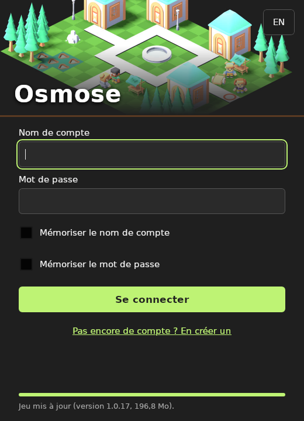
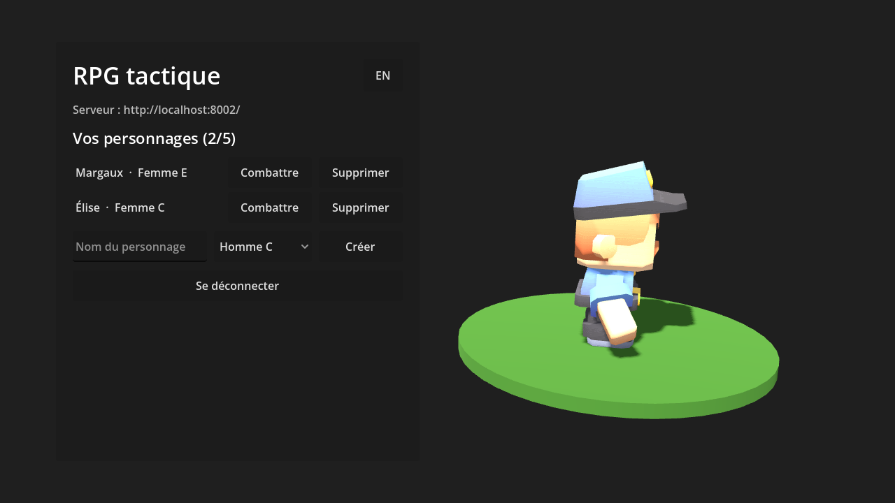
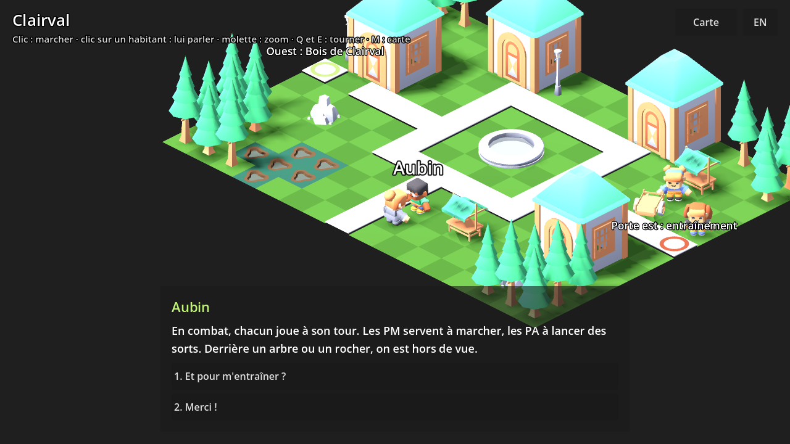
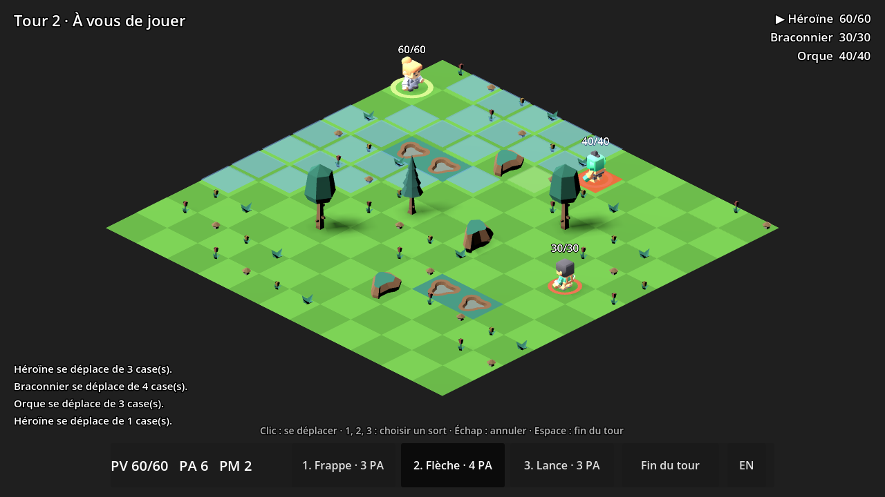

# rpg : Osmose, un RPG tactique à la manière de Dofus

[](https://github.com/Dzop86/Portfolio/actions/workflows/rpg.yml)

Un RPG tactique au tour par tour, dans l'esprit de Dofus et de Wakfu, écrit de zéro : aucun code, aucun nom, aucune image d'Ankama (D54). Six sprints : les règles du combat (sprint 45, ce dossier), le combat isométrique dans Godot 4 (46), le serveur de comptes et de personnages (47), la création de personnage (48), la ville d'accueil et ses PNJ (49), le launcher en Rust et les exécutables (50). Solo d'abord ; le multijoueur viendra plus tard, sur ces mêmes règles.

*A turn-based tactical RPG in the style of Dofus and Wakfu, written from scratch. Sprint 100: the trades window (key J): the gathering and making trades with their level and experience, the recipes searched, filtered and sorted, each ingredient owned over needed, the resources and where they grow; at a workshop, it makes. Sprint 99: gathering: woodcutter, miner, fisher, farmer and herbalist, a new resource every five levels, forty of them from level 1 to 35 on seven to ten spots of every map of the zones, a gem in the trade's colour over each; three seconds by a spot, the server giving the resource and the trade's experience, the spot growing back after a few minutes for everyone. Sprint 98: every item has a real icon, a game-icons.net drawing in the item's colour on a dark tile, framed by where it comes from: grey for the common, chocolate for a craftsman's work, pistachio for a set's piece, gold for a chief's. Sprint 97: Rose's stall opens in the village: she buys back resources and equipment and sells the monsters' resources dearer; taking back characteristic points costs Éclats from level 11, and the locksmith's keys cost Éclats too. Sprint 96: the Lake's and the Fields' sets, the frogs and the bees quick ones; every family now leaves a set of five pieces. Sprint 95: the main quest's step under the wallow done alone (its great hall, the key given with the quest); initiative found on boots, capes and rings left by monsters, which lets a hero play before them, the heroes first on a tie; a set of five pieces for each family of the Woods and the Mouldy Woods, one left by each monster, the chief's weapon more often; the initiative on the fighters' cards and who one plays before on the sheet; a simulator that dresses its heroes (`--kit`). Sprint 94: the fields' families redone: bees that alert their neighbours when struck, a drone stinging with fire and wax, a nurse giving an action point, a queen laying young workers and her hive overheating; moles surfacing out of sight next to their prey, throwing clods in the eyes, caving in, burrowing down when hurt, their king digging up a shard of unknown metal while two young diggers surface; weak to Earth and to Water; the Hedgerows; each dungeon's great hall fought on its family's second map; character names of a capital and letters only, the characteristics and the inventory shown in a fight (C and I). Sprint 93: the lake's families redone: frogs that heal themselves each turn, leap and pull with their tongues, a bullfrog that bounces whoever strikes it, the toad king's lullaby taking two action points; crabs in armour, weak to Air, that grip, push with bubbles, hide in their shells and change places with a hurt crab, then molt below two fifths of their hit points, faster and stronger but bare; the giant crab's carved figurehead and a young hermit; a second battle map, the Pontoons. Sprint 92: the mouldy woods' families redone: mushrooms that leave poisoning spores at their death, a puffball that bursts, a cap sheltering its neighbours, an elder planting cuttings and rooting itself when hurt; zombies each striking in an element of its own and poisoning whoever strikes them up close, a bloater that explodes on its own allies too, an overlord letting a bloater come away; weak to Fire and to Water; a second battle map, the Mouldy Pools. Sprint 91: the woods' families redone: boars that charge into trees, trample, flee and avenge one another, their king lighting the etched shard in his tusk; wolves that leap, rally and take a hurt wolf's place, stronger together, their leader calling two cubs; weak to Air and to Fire; a second battle map, the Thicket. Sprint 90: the monster families' engine: passives (at the start of a turn, when struck, below some hit points, when an ally of the family falls, at death), resolved in order after each action and replayed roll for roll; a leap and a place swap; several battle maps per family; statuses of action and movement points count at once on the fighter playing (Sidestep, Momentum and Mana Surge did nothing before), the classes' hit points balanced again. Sprint 89: the first quests: the start of the main quest from Ysaline, a scholar standing by the village's old stone, which showed a fifth sign and cracked (four steps, up to the Boar King's wallow and the four trails of the Primordials); two side quests in every zone and one for every dungeon, all given in the village. Sprint 88: quests given by the inhabitants, offered and taken back in their talks: talking to someone, defeating monsters of a family, bringing items, finishing a dungeon, followed and rewarded by the server (experience, Éclats, items); a journal (key Q) zone by zone, under way and done; a first quest from Aubin. Sprint 87: an end-of-fight window as in the games of the genre: Victory or Defeat, the winners and the losers, the player's experience bar, experience, Éclats (the new money, kept by the server) and loot as icons, a statistics tab (damage dealt and taken, healing, shields, enemies finished off), and "Close" alone, leaving the player where they stood. Sprint 86: real dungeons: a stone keep with four towers over the door; each room a hall one walks in, with a keeper to talk to, a fountain that heals, the room's group guarding the far door until it is beaten (a right click to attack it); the hit points left go from room to room, kept and checked by the server; the way out keeps one's progress. Sprint 85: clearer maps: half the decor, borders open on a third to a half of each side, a click near an edge or beyond the map leads that way, a light grid on the world map; the spell icons no longer turn into white squares; a chat that shows only when a line comes in; windows moved by their header; a right click on monsters reaching their whole body. Sprint 84: a proximity chat: Enter to talk, Escape or a click on the map to leave; lines go by WebSocket to the players of the same map only, cleaned and paced by the server. Sprint 83: maps changed as in the games of the genre: near an edge with a way out, an arrow under the mouse, and a click walks round the decor to the way and through it; the zoom kept from map to map; no more turning the view; walking 20 % faster; the dungeons' doors on the world map. Sprint 82: a deck of 0 to 12 spells of any elements, built by drag and drop, emptied with a button and shared as a short code ("MAGE-DAR"); the game signs in again by itself when its session has run out, so saving the deck and points no longer fails. Sprint 81: the locksmith's trade: at the bench in Clairval, each dungeon's key made from its family's two resources, from a trade level that follows the zone's, the trade's level and experience kept by the server; every monster also leaves its dungeon's key now and then (2 %, the chief 10 %). Sprint 80: a dungeon per family, its door on the chief's map, three rooms (one monster of each role weakened, the same at full strength, the same and the chief), entered with its key, used up, or the operator's keyring; the server keeps the room one is at and gives the last one's experience twice. Sprint 79: the game's sign-in screen remembers the account name and, sealed for this user on this computer, the password; a fallen fighter leaves the board; a small clock and the round's number start the timeline; an operator's command on the server (`admin ACCOUNT --level N --give ITEM`). Sprint 78: the fight's timeline shows the current round only, the one playing outlined, and starts again each round; a right click on monsters opens their menu with "Attack" (a left click only walks up to them); without the launcher the game asks for the account and password itself, and no longer offers to play offline (`--offline` stays for tests). Sprint 77: zone maps of 48 × 32 cells instead of 16 × 12, ways named only by the zone they lead to, the world seen from the sky at 4 pixels a cell. Sprint 76: Clairval Fields, 25 maps south of the woods in flowers and hedges, their bees and moles; the world now has four zones of 25 maps and the village, 101 maps, eight families of monsters. Sprint 75: Reed Lake, 25 maps north of the woods round a great lake crossed by pontoons, an islet on every map, its frogs and crabs; a group of monsters never stands, nor wanders, where it would cut a map in two. Sprint 74: the mouldy woods, 25 maps west of the woods with giant mushrooms and pools, their mushrooms and zombies; every map now has two to four groups of one to ten monsters, the groups of one to three made for a player alone at the zone's level, those of six and more for several players (Charles's rule), every family balanced again by simulation. Sprint 73: the wolves, the woods' second family (grey wolf, howler, great male, she-wolf guarding the pack, pack leader), met with the boars map by map, balanced by simulation. Sprint 72: monsters. A family is five monsters of one kind, one per role (melee, ranged, tank, support, boss); the boars live in the woods, two groups on every map, drawn from the map's name, wandering around their home; a click walks up to a group and starts its fight, which the server builds, checks and rewards like any other; a beaten group comes back two minutes later; balanced by simulation. Sprint 71: the world map shows the world seen from the sky, every map in its place as one big map (each cell drawn after what stands on it), dragged and zoomed around the pointer, the player marked and the map under the pointer named. Sprint 70: a world made of maps the size of a screen, a zone being a grid of 5 × 5 of them joined by openings on their edges; the woods west of the village come first (25 maps written by a script), each map titled with its place in the world, the world map showing every map in its place. Sprint 69: an Escape menu (overall, music and effects volumes, mute, change server or character, quit), a discreet side bar of icons opening the characteristics, spells, inventory and map windows (keys C, S, I, M), free sounds (Kenney, CC0) and a village tune made by a script, and free walking outside fights: eight directions, straight lines, a new click turning the walk. Sprint 68: a deck of twelve spells chosen among those unlocked, kept and checked by the server, played from a bar of two rows of six with their icons and colours (keys 1 to 6 and Ctrl+1 to 6). Sprint 67: twenty-four spells per class, four per element and eight neutral ones, five at level 1 then one every five levels up to 95, each with a game-icons.net icon (CC BY 3.0) on its element's colour; the classes balanced again by simulation. Sprint 66: the characteristics named after their elements (Vitality, Earth, Water, Fire, Air) in their own colours, each giving only its element's damage, 8 AP, 4 MP and 10 initiative for every class, and points taken back and spent again at any time. Sprint 65: a spells screen (the class's twenty spells in the colour of their element, locked until their level, normal and critical damage counting the character's points and equipment, a card with everything and the next rank) and an inventory as in the games of the genre (the character in 3D surrounded by its fourteen slots, tabs, a search, a grid of icons drawn by the game). Sprint 64: characteristics that count as in the games of the genre (10 points in an element = +2 damage in that element only), critical hits with their own range, a spell about every five levels, level 1 balanced again by simulation, and a characteristics sheet showing the points put in, those of the equipment and what they give. Sprint 60: large zones described in data (a 30 × 22 wood of level 3, a 30 × 26 heath of level 10) linked to the village and to each other by ways, an explore camera that follows the player, zooms and turns a quarter at a time, a world map, and the server keeping the zone and cell one stands on. Sprint 59: fourteen equipment slots, items with a level and characteristics, sets, an inventory in pages (all, equipment, consumables, resources, quest items) and loot drawn from the server's seed, all kept and checked by the server. Sprint 58: experience and levels 1 to 100 (nothing from a monster 20 levels below, a group bonus, a first quest), 10 characteristic points and 1 spell point a level spent on a Character screen; the server draws each fight's seed, takes its record once, replays it and only then gives the experience. Sprint 57: a readable fight: hovering a fighter shows its points, resistances and statuses, aiming a spell forecasts its damage and healing on each fighter of its area, spells have full cards, the turn order is a timeline of 3D portraits, and bolts, area flashes and numbers take the colour of their element. Sprint 56: the three classes redone, twenty spells each unlocked from level 1 to 100 on two elements, shown on the creation screen; cooldowns, erosion of maximum hit points, statuses renewed rather than stacked; an AI that plans its turn; class duels in the simulator, balanced at level 1. Sprint 55: characteristics (Vitality, Strength, Intelligence, Chance, Agility) in hit points, damage and healing; spells with an unlocking level and up to five ranks; summons that join the caster's team and are played by the AI. Sprint 54: four elements and resistances, spell areas (cross, circle, line) and effects (heal, shield, push and pull with collision damage, poison and statuses over turns), described in data, replayed roll for roll, used by the AI. Sprint 53: a full-screen character creation (class, look, outfit, hair and skin colours, height and build) on Kenney's models, kept by Charles after a comparison with KayKit and Quaternius; every value checked by the server. Sprint 52: as in the games of the genre, the game opens on the server choice (Osméria, straight through while it is alone) then on the characters as cards (3D portrait, name, class, level), each character living on a server; without the launcher, the game only offers to open it or to play offline. Sprint 51: the launcher redone: it updates the game by itself, an account name, a password and "Sign in" (which starts the game), remembering the name and the password (in the system's credential store), sign-up, the server hidden, a banner of the village. Sprint 50: a Rust launcher (Tauri) that signs in, updates the game file by file from a versioned SHA-256 manifest, resumes cut downloads with HTTP ranges and starts the game with the token; unsigned packages for Windows, macOS and Linux built by the CI; a video and an architecture diagram on the project page. Sprint 49: a welcome town built from Kenney's Fantasy Town Kit, walked with a click along the shortest path, three inhabitants with bilingual dialogues and choices described in data, the character's place saved on the server, a gate to a training fight. Sprint 48: character creation with three classes described in data (characteristics and spells, balanced by simulation), twelve looks and seven outfit colours (a palette shader), checked by the server. Sprint 47: an ASP.NET Core server for accounts and characters (JWT, PBKDF2 password hashes, rate limit, EF Core and PostgreSQL, OpenAPI, Docker), and the game's login and character screen, tested end to end against it, with an offline mode. Sprint 46: a Godot 4 C# desktop client (isometric 3D board, Kenney's free animated models, mouse and keyboard play against the AI, a self-test that plays a whole fight through the controls, builds for Windows, macOS and Linux). Sprint 45: the combat rules in a deterministic C# library (isometric grid, action and movement points, A* paths, exact line of sight, spells, initiative, an AI), described by data files, recorded fights that replay roll for roll on Linux, Windows and macOS, and a terminal simulator.*

## Les règles
- **Le plateau** est une grille de cases dessinées en losanges (vue isométrique). On se déplace vers l'une des quatre cases qui partagent un côté ; toutes les distances se comptent en pas, donc une portée dessine un losange autour du lanceur. Trois terrains : le sol, les obstacles (ni passage ni vue) et les trous (pas de passage, mais les sorts passent au-dessus).
- **Un tour** : chaque combattant a des points d'action (PA) et de mouvement (PM), rendus au début de son tour. Un pas coûte 1 PM ; un sort coûte ses PA. On joue dans l'ordre d'initiative.
- **Les classes** (`data/classes.json`) : le héros du joueur prend les points de vie, PA, PM, l'initiative et les sorts de la sienne, débloqués par son niveau, et gagne à chaque niveau des PV propres à sa classe. Chacune a 24 sorts, quatre par élément et huit neutres (T34), montrés à la création, et toutes ont 8 PA, 4 PM et 10 d'initiative (D62) : Sentinelle (62 PV : tir à distance, poussées, entraves), Garde (74 PV : corps à corps, attirance, boucliers), Mage (86 PV : zones, soins des alliés, invocation).
- **Les passifs des monstres** (`data/passives.json`, T57) : jusqu'à trois par monstre, déclenchés au début de son tour, quand un sort le frappe (au contact, s'il le faut), sous un seuil de PV (une fois), à la mort d'un allié de sa famille ou à sa propre mort ; ils appliquent les effets des sorts, avec leur porteur pour lanceur. Deux effets de déplacement : le saut sur une case libre et l'échange de place.
- **La progression** (`Progression`, T29) : l'XP des combats gagnés (un monstre vaut 20 + 10 × son niveau, rien s'il a 20 niveaux de moins que le héros, +10 % par allié) et des quêtes (`data/quests.json`), le niveau qu'elle donne (100 XP pour le niveau 2, 495 000 pour le 100), 10 points de caractéristique et 1 point de sort par niveau ; un rang coûte 1, 3, 6 puis 10 points en tout.
- **Les monstres** (T39) : `data/monsters.json` décrit les familles, chacune de cinq monstres de la même espèce, un par rôle (DPS mêlée, DPS distance, tank, support, boss ; le chargement refuse une famille à qui il en manque un ou qui en a deux), leur zone, leur carte de combat et la carte de leur chef. Deux familles vivent dans le bois : les sangliers (sanglier chargeur, marcassin lance-glands, vieux solitaire, laie qui soigne, roi des sangliers) et les loups (loup gris, loup hurleur, grand mâle, louve qui protège la meute d'un bouclier, chef de meute) ; chaque groupe est d'une seule des deux. `MonsterGroups` tire deux à quatre groupes par carte de la zone d'après le nom de la carte (le même partout : jeu, serveur, tests), chacun d'une seule famille et de un à dix monstres : un à trois près de l'entrée de la zone, jusqu'à six un peu plus loin, jusqu'à dix au fond (`Depth`) ; un soutien jamais seul, un pour trois au plus ; chaque chef sur sa carte avec cinq à neuf des siens. Règle de Charles : un joueur seul bat facilement un groupe de un à trois au niveau de la zone ; un groupe de six à dix est fait pour plusieurs. Le bois moisi a ses champignons (champignon cogneur, vesse-de-loup, gros chapeau, morille guérisseuse, champignon ancestral) et ses zombies (zombie cogneur, cracheur, bouffi, rebouteux, colossal) ; le lac ses grenouilles (bagarreuse, cracheuse, crapaud buffle, rainette guérisseuse, crapaud-roi) et ses crabes (pinceur, à bulles, cuirassé, bernard-l'ermite qui protège, crabe géant) ; les champs leurs abeilles (ouvrière, archère, faux-bourdon, nourricière, reine) et leurs taupes (fouisseuse, lance-mottes, vieille taupe, mère taupe qui protège, taupe-roi). Un groupe ne s'installe ni n'erre jamais là où il couperait une carte en deux (un ponton : `MonsterGroups.KeepsWaysOpen`). Combattre un groupe est le scénario `group:` suivi de son identifiant, que les règles construisent : le serveur le lance, le rejoue et le récompense (XP selon le niveau des monstres, butin) comme les autres. En ville, les groupes errent à quelques pas de chez eux (`Roaming`), un clic va jusqu'à eux et lance le combat, un groupe battu revient deux minutes plus tard (`MonsterPresence`). Les modèles sont construits par le jeu (`Creatures`), en blocs, la taille et les détails disant le rôle (crête, rayures, défenses, couronne ; masque, collerette, cicatrice ; chapeaux tachetés, vesse ronde, morille ; zombies en haillons, bras tendus, recousus, bouffis ; grenouilles trapues aux gros yeux, rayées, verruqueuses ; crabes aux pinces levées, à bulles, à piquants, à coquille ; abeilles rayées qui volent, ailes et dard ; taupes au groin rose, aux mains fouisseuses, casquées, en tablier) ; un grand groupe montre trois de ses monstres, son nom dit combien ils sont (« Sangliers ×7 (niv. 1 à 5) »).
- **Le monde** (T31, T37) : des cartes de la taille d'un écran décrites en données (`data/towns/`), chacune avec un niveau, une place dans le monde (`mapAt`, une case par carte) et des passages vers ses voisines (on en prend un en s'arrêtant dessus). Une zone est une grille de 5 × 5 cartes de 48 × 32 cases (16 × 12 avant le sprint 77) du même nom (`zone`), ouvertes l'une sur l'autre par trois cases de leurs bords ; seul un passage vers une autre zone porte un nom, celui de la zone (D64) ; le titre donne la zone et la place, « Bois de Clairval [-3, 0] ». Le chargement refuse un passage inaccessible, une arrivée impossible, un passage qui n'est pas sur le bord tourné vers la carte voisine ou n'arrive pas sur le bord d'en face, et deux cartes à la même place. Aujourd'hui : le village de Clairval en [0, 0], le Bois de Clairval à l'ouest (25 cartes, de [-5, -2] à [-1, 2]) le Bois moisi plus à l'ouest (25 cartes, de [-10, -2] à [-6, 2], ouvert sur le bois par deux cartes) le Lac des Joncs au nord du bois (25 cartes, de [-5, -7] à [-1, -3] : un grand lac au milieu de la zone, traversé de pontons, un îlot au centre de chaque carte) et les Champs de Clairval au sud du bois (25 cartes, de [-5, 3] à [-1, 7], en fleurs et en haies) : 101 cartes en tout, les zones de niveau 3, 10, 18 et 26. Chaque zone a sa teinte d'herbe (`ZoneStyle`) et ses décors : champignons géants `M`, buissons et haies `B`, fleurs `,` (où l'on marche). La carte du monde (M) montre le monde vu du ciel, comme une seule grande carte : `WorldPicture` (dans `Rpg.Client`, sans moteur) pose chaque carte à sa place et dessine chaque case en 4 × 4 pixels d'après ce qui s'y trouve (herbe en damier, routes, arbres vus d'en haut, eau, rochers, toits, fontaine) ; on la fait glisser à la souris, on zoome à la molette autour du pointeur, de tout le monde à quatre fois, un anneau marque le joueur et la carte survolée est nommée avec son niveau.
- **L'équipement** (`Equipment`, T30) : quatorze emplacements, une arme à deux mains seule ; les objets (`data/items.json`) donnent caractéristiques, PA et PM à partir de leur niveau, les panoplies (`data/sets.json`) des bonus selon le nombre de pièces ; les monstres laissent un butin (`loot`) tiré d'après la graine du combat.
- **La relance, l'érosion** : après un lancer, un sort à relance attend autant de tours de son lanceur. 10 % des dégâts reçus sont aussi retirés des PV maximum, jusqu'à la fin du combat : les soins ne les rendent pas. Un même état d'un même lanceur se renouvelle au lieu de s'additionner.
- **Les éléments et les effets** : chaque sort frappe dans un élément (Terre, Feu, Eau, Air, ou neutre), que les combattants résistent en pourcentage (au plus 90 %). Un sort peut toucher une zone (croix, cercle ou ligne) : ses dégâts frappent tous les combattants de la zone, alliés compris ; ses effets suivent, chacun pour les ennemis, les alliés, tous, ou le lanceur : soin, bouclier (qui prend les dégâts d'abord, pendant quelques tours), poussée (chaque case non parcourue contre un obstacle, un combattant ou le bord coûte 4 PV) et attirance, états pour quelques tours (poison au début du tour, plus ou moins de PA, de PM, de dégâts, de résistance). Les états se décomptent à la fin de chaque tour de celui qui les porte.
- **Les coups critiques** (T32) : chaque sort a sa chance de critique (10 % pour les sorts du jeu) ; un critique ajoute un cinquième du maximum, arrondi, aux deux bornes (5 à 10 devient 7 à 12), dégâts comme soins. La prévision du combat montre les deux fourchettes.
- **Les caractéristiques** : Vitalité (1 PV par point), Force (Terre et neutre), Intelligence (Feu, et les soins), Chance (Eau), Agilité (Air) : 10 points donnent +2 dégâts dans leur élément, et dans aucun autre (+2 soins pour l'Intelligence, T32). Un sort a un niveau de déblocage et jusqu'à cinq rangs, chacun pouvant changer ses dégâts, son coût, sa portée maximale ou ses lancers par tour ; un héros reçoit les sorts de sa classe débloqués à son niveau (100 au plus). Un sort peut invoquer une créature de `data/summons.json` sur une case libre : elle rejoint l'équipe du lanceur, joue juste après lui, est jouée par l'IA et meurt avec lui.
- **Les sorts** ont une portée minimale et maximale, demandent ou non la ligne de vue, peuvent n'être lancés qu'en ligne droite et un nombre de fois limité par tour. Les dégâts sont tirés entre deux bornes.
- **La ligne de vue** suit exactement le segment entre les centres des deux cases, en nombres entiers : si A voit B, B voit A. Les obstacles et les combattants la coupent, les trous non. Un segment qui passe pile par un coin n'est coupé que si les deux cases de part et d'autre bloquent.
- **La fin** : une équipe qui n'a plus personne a perdu ; au-delà de 50 tours, match nul.

```
...........      a Héros 20/60
.....a.....      B Sanglier 0/30
....#......      C Crapaud 0/22
..~~...#...
...........      # obstacle   ~ trou
```

## Jouer
Avec le SDK .NET 10 et Godot 4.7 (version .NET) :
```sh
dotnet build godot/Rpg.Godot.csproj
docker compose up --build rpg-api          # depuis la racine du dépôt : le serveur, sur le port 8002
godot --path godot -- --lang fr            # options : --server URL, --offline (tests et captures), --scenario duel, --seed 7
```
Le jeu s'ouvre sur l'écran de connexion : créer un compte ou se connecter, puis créer un personnage (un nom, l'une des 12 apparences, une classe et l'une des 7 couleurs de tenue ; le modèle, repeint, tourne à côté du formulaire) et le choisir. On arrive au village de Clairval : un clic fait marcher par le plus court chemin (montré en jaune), un clic sur un habitant y mène et ouvre la conversation (réponses au clic ou aux touches 1 à 4), la porte est et Garance mènent au combat d'entraînement ; à la fin du combat, « Retour en ville », et « Personnages » ramène à la liste. Ouvert sans le launcher, le jeu demande lui-même le compte et le mot de passe ; il ne propose plus de jouer hors ligne (sprint 78), `--offline` reste pour les tests et les captures. Dehors, un clic droit sur des monstres ouvre leur menu, « Attaquer » lance le combat ; en combat, la frise montre l'ordre du tour en cours. Ou sans rien installer : les exécutables Windows, macOS et Linux produits par la CI (artefacts du workflow `rpg`, non signés : Windows et macOS avertissent au premier lancement).

**Le launcher** (`launcher/`, Rust et Tauri) : paquets `rpg-launcher-*` des artefacts de la CI (`.deb` et AppImage, installeur Windows, `.dmg`), éditeur « Osmose Team », non signés eux aussi. À l'ouverture, il met le jeu à jour tout seul : il compare le jeu installé au manifeste publié (taille et SHA-256 de chaque fichier), ne télécharge que les fichiers modifiés, reprend un téléchargement coupé et vérifie chaque fichier. La fenêtre ne demande que le nom de compte et le mot de passe : « Se connecter » attend la fin de la mise à jour puis lance le jeu avec le jeton (variables `RPG_SERVER` et `RPG_TOKEN` : le jeu s'ouvre directement sur les personnages). Deux cases mémorisent le nom (fichier `launcher.json` du dossier de configuration) et le mot de passe (gestionnaire d'identifiants de Windows, trousseau de macOS, Secret Service sous Linux ; jamais dans un fichier). Un lien permet de créer un compte. L'adresse du serveur n'est plus affichée : `RPG_SERVER`, ou `"server"` dans `launcher.json`, la change. Pour publier une version en local :
```sh
godot --headless --path godot --export-release Linux               # dans godot/build/linux
cargo run --manifest-path launcher/Cargo.toml -p rpg-launcher-core --bin rpg-manifest -- godot/build/linux 1.0.0
docker compose up --build rpg-api                                  # sert godot/build sous /updates
# godot/build doit exister avant : sinon Docker le crée au nom de root, et l'export ne peut plus y écrire.
cargo run --manifest-path launcher/Cargo.toml -p rpg-launcher-core --bin rpg-update -- http://localhost:8002 ./jeu linux
cd launcher/app && npx @tauri-apps/cli@2.5.0 dev                   # la fenêtre du launcher
```



- **Souris** : survoler une case montre le chemin (jaune) parmi les cases atteignables (bleu clair) ; cliquer s'y rend. Avec un sort choisi, sa portée est marquée, les cases qu'il peut toucher en bleu, la cible en rouge ; clic droit pour annuler.
- **Clavier** : 1, 2, 3 choisissent un sort, Échap annule, Espace finit le tour. Le bouton FR/EN change de langue.





## Organisation
- **`src/Rpg.Core`** (net10.0, sans dépendance) :
  - `Cell.cs` : cases, voisins, distances.
  - `Board.cs` : le plateau, lu depuis des lignes de caractères.
  - `Pathfinding.cs` : plus court chemin par A* (égalités départagées dans un ordre fixe), cases atteignables par parcours en largeur.
  - `LineOfSight.cs` : les cases traversées par le segment, coins compris, sans arrondi.
  - `Fight.cs`, `Actions.cs` : le combat ; chaque action est vérifiée, une action refusée ne change rien et dit pourquoi ; les événements (déplacement, sort, dégâts, mort, fin) servent à l'affichage.
  - `Ai.cs` : un adversaire déterministe (frapper le plus fort, sinon se placer, sinon s'approcher en contournant les obstacles).
  - `FightRecord.cs` : un combat enregistré (scénario, graine, actions) et son rejeu.
  - `Data.cs` : sorts, cartes et scénarios lus depuis `data/`, refusés s'ils sont incohérents.
- **`src/Rpg.Sim`** : le simulateur en ligne de commande.
- **`src/Rpg.Api`** (ASP.NET Core, API minimale) : le serveur des comptes et des personnages.
  - `GET /api/servers` (les serveurs de jeu, tirés de la configuration `Servers:N:Id` / `Servers:N:Name` ; Osméria par défaut), `POST /api/accounts` (créer un compte), `POST /api/tokens` (se connecter : un jeton JWT valable 12 heures), `GET`, `POST /api/characters`, `DELETE /api/characters/{id}`, `PUT /api/characters/{id}/place` ; progression (T29) : `POST /api/characters/{id}/fights` (le serveur tire la graine d'un combat), `POST /api/characters/{id}/fights/{fight}` (l'enregistrement, une seule fois : rejoué, puis l'XP), `PUT /api/characters/{id}/points` (caractéristiques et rangs, dans les limites du niveau), `PUT /api/characters/{id}/equipment` (ce qui est porté, parmi ce qui est possédé) ; le rejeu d'un combat ajoute aussi son butin à l'inventaire et `PUT /api/characters/{id}/place` (où il se tient en ville : refusé si l'on ne peut pas y marcher depuis l'arrivée) (avec le jeton) ; description OpenAPI sur `/openapi/v1.json`, Swagger UI sur `/swagger`.
  - Mots de passe hachés par PBKDF2 (le `PasswordHasher` d'ASP.NET Core Identity) ; un nom inconnu coûte autant qu'un mauvais mot de passe, et la réponse est la même. Inscription et connexion limitées à 10 essais par minute et par adresse.
  - Noms de compte uniques, noms de personnage uniques sur tout le serveur, sans tenir compte de la casse (index unique sur le nom en majuscules : deux créations simultanées ne passent pas toutes les deux) ; cinq personnages au plus par compte ; le personnage d'un autre se comporte comme un personnage absent (404).
  - EF Core 10 et PostgreSQL (Npgsql), migrations par `dotnet ef` (outil épinglé dans `.config/dotnet-tools.json`), appliquées au démarrage. Image Docker « chiseled » (sans shell, utilisateur non root), service `rpg-api` de `compose.yaml` avec sa base `rpg-db`, qui n'est pas exposée.
- **`src/Rpg.Client`** : en plus du combat, `GameServer` (les appels HTTP du jeu, partagés avec les tests) et `Lobby` (ce que l'écran de connexion peut faire : chaque refus devient un message des deux langues, les vérifications du serveur sont faites d'abord sur place, un serveur injoignable invite à réessayer).
- **`src/Rpg.Client`** (sans Godot) : le côté joueur d'un combat, testé sans moteur : sort choisi, aperçu au survol (`Hover`), clic (`Click`), fin de tour, tours de l'IA, textes français et anglais, et `SelfPlay`, qui joue un combat entier en passant par ces commandes.
- **`godot/`** : le client Godot 4.7 en C#. Il ne fait que dessiner : `BoardView` (plateau 3D, surbrillances, case sous la souris par un rayon de la caméra), `FighterView` (modèle animé, anneau d'équipe, PV, dégâts), `Hud` (tour, ordre de jeu, sorts, journal, fin), `LobbyView` (l'écran de connexion et des personnages), `Main` (l'écran de connexion puis le combat, enchaîne les animations, fait jouer l'IA, options `--selftest`, `--lobby-selftest` et `--screenshot`). Modèles 3D de Kenney (CC0, licences dans `godot/assets/kenney/`). Icônes des sorts et de la barre latérale de game-icons.net (CC BY 3.0) : Lorc, Delapouite et Sbed ; l'auteur de chaque icône dans `godot/assets/icons/spells/credits.json` et `godot/assets/icons/bar/credits.json`, le fond noir retiré, posées sur la couleur de l'élément (`SpellIcon`). Icônes des objets de game-icons.net (CC BY 3.0, depuis le sprint 98) : andymeneely, cathelineau, delapouite, lorc, lucasms, skoll ; l'auteur de chaque dessin dans `godot/assets/icons/items/credits.json`, le dessin blanc teint de la couleur de l'objet sur une tuile sombre, son cadre selon sa provenance (`ItemIcon`). Sons de Kenney (RPG Audio, Interface Sounds, Music Jingles ; CC0, origine de chacun dans `godot/assets/kenney/sounds/sources.json`) ; `Sound` les joue sur un bus « Effets », la musique du village sur un bus « Musique ». `SideBar` (les icônes à droite, nom et touche au survol) et `MenuPanel` (le menu Échap) ; l'état des fenêtres et du menu, sans moteur, est `WindowState` dans `Rpg.Client`, les réglages du son `AudioSettings` (fichier `settings.txt` du joueur).
- **`godot/shaders/outfit.gdshader`** : la couleur de tenue. La texture des personnages de Kenney est une palette de cases ; le shader décale les sept colonnes colorées (vert à violet) de 0 à 6 crans, si bien que vêtements et accessoires changent ensemble sans toucher à la peau, aux cheveux ni aux gris. `Looks.MainColumn` lit dans le maillage la couleur dominante de chaque apparence, pour que chaque pastille montre la teinte réellement obtenue.
- **La ville** : `data/towns/*.json` décrit la carte en lignes de caractères (`.` herbe, `=` route, `H` maison de 2 × 2 cases, `F` fontaine, `T` arbre, `R` rocher, `S` étal, `L` lanterne, `C` charrette, `~` eau), l'arrivée, les habitants (apparence, couleur, case, dialogue) et les portes (vers quel combat) ; `data/dialogues/*.json`, les répliques et les réponses (vers une autre réplique, la fin, ou un combat). Au chargement, chaque habitant et chaque porte doivent être accessibles à pied depuis l'arrivée, chaque réplique atteignable, et chaque conversation doit pouvoir finir. `Rpg.Client` : `TownController` (ce qu'un clic fait en ville ; hors combat on marche en huit directions, `Wander` : A* sans couper le coin d'un mur, puis le chemin tendu en lignes droites qui gardent 0,3 case de marge ; un nouveau clic en cours de marche arrête le joueur là où il est et repart de là) et `TownTour` (tout le village par ces clics, pour l'auto-test) ; `godot/` : `TownView` (le village 3D, maisons montées à partir des murs et des toits du Fantasy Town Kit de Kenney, CC0), `TalkPanel` (la conversation), `Main.Town.cs`.
- **`launcher/`** (Rust) : `core`, une bibliothèque testée sans fenêtre (`manifest` : manifeste, empreintes, plan de mise à jour, refus d'un chemin qui sortirait du dossier du jeu ; `update` : téléchargement avec reprise par en-tête `Range`, vérification, mise à jour complète, manifeste local écrit en dernier ; `server` : connexion ; `launch` : commande du jeu) et ses deux outils, `rpg-manifest` et `rpg-update` ; `app`, la fenêtre Tauri (le jeton reste du côté Rust, la page ne le voit jamais) ; `ui`, la page (HTML, CSS, JavaScript, français et anglais).
- **`data/`** : `spells.json`, `classes.json`, `towns/*.json`, `dialogues/*.json`, `maps/*.json`, `scenarios/*.json` (chaque combattant y a un `look`, le modèle 3D qui le montre). Ajouter un sort, une carte ou un monstre se fait ici, sans toucher au code ; les fichiers sont intégrés à `Rpg.Core`, donc le jeu exporté, le serveur et les tests lisent les mêmes.
- **`samples/`** : deux combats de l'IA, rejoués par la CI sur les trois systèmes.
- **`tools/world_gen.py`** : écrit les cartes des zones (`python3 tools/world_gen.py data mouldy`, déterministe ; le bois toujours, les autres zones nommées) : bord d'arbres ouvert sur les voisines, bouquets d'arbres, rochers, parfois une mare, un sentier libre de chaque ouverture au centre ; chaque ouverture et chaque sortie vérifiées accessibles depuis l'arrivée de la carte.
- **`tools/music_gen.py`** : écrit la musique du village (`godot/assets/music/village.wav`, huit mesures en boucle, Python seul, même fichier à chaque fois) : les packs de Kenney n'ont que des jingles.
- **`tools/spells_gen.py`** : écrit les 62 sorts et les listes des classes ; il porte la règle de dégâts par PA de T27 (`python3 tools/spells_gen.py data`).
- **`tools/sets_gen.py`** : écrit les panoplies des familles (pièces, bonus, butin), après `tools/dungeon_gen.py` (`python3 tools/sets_gen.py data`, déterministe ; T63).
- **`tools/trades_gen.py`** : écrit les métiers de récolte et leurs 40 ressources (`python3 tools/trades_gen.py data`, après `sets_gen.py` ; T67).
- **`tools/icons_gen.py`** : donne à chaque objet son dessin game-icons.net (`python3 tools/icons_gen.py data [--fetch]`), à lancer en dernier, après `dungeon_gen.py` et `sets_gen.py` qui réécrivent des objets (T66).

## Lancer
SDK .NET 10 :
```sh
dotnet test --project tests/Rpg.Core.Tests
dotnet run --project src/Rpg.Sim -- --simulate 1000 --scenario duel
dotnet run --project src/Rpg.Sim -- --record combat.json --scenario training --seed 7 --lang fr
dotnet run --project src/Rpg.Sim -- --replay combat.json --show --lang fr
```
Le serveur et ses tests demandent PostgreSQL :
```sh
docker run -d --name rpg-pg -p 5432:5432 -e POSTGRES_HOST_AUTH_METHOD=trust postgres:18-alpine
RPG_TEST_DB="Host=localhost;Username=postgres" dotnet test --project tests/Rpg.Api.Tests
ConnectionStrings__Game="Host=localhost;Username=postgres;Database=rpg" dotnet run --project src/Rpg.Api
scripts/smoke.sh http://localhost:8002     # contre docker compose : de l'inscription au refus d'une requête trop grosse
```
La clé qui signe les jetons vient de `Jwt__Key` (base64, 32 octets, variable d'environnement ; `RPG_JWT_KEY` pour docker compose). Sans clé, le serveur en tire une au démarrage, et les jetons ne survivent pas à un redémarrage.

## Tests
Sprint 100 : 3 tests de plus dans `Rpg.Client` (les métiers, la récolte d'abord, leur niveau et l'XP dans le niveau ; les recettes cherchées, filtrées, triées, fabriquées seulement à l'atelier ; les 20 ressources d'un métier de récolte et où elles poussent), 3 retirés avec l'ancien panneau de l'établi. `--town-selftest` ouvre l'établi sur la fenêtre Métiers.

Sprint 99 : 6 tests de plus (`Rpg.Core` : cinq métiers de récolte, une ressource tous les 5 niveaux ; des points sur chaque carte de zone, sur le bon décor, loin des passages, aucun au village, les 40 ressources quelque part ; quantité, XP et repousse ; `Rpg.Client` : un clic sur un point mène à côté et demande la récolte, une marche l'annule ; `Rpg.Api` : la récolte à côté du point, au niveau du métier, le point qui repousse pour tous). `--town-selftest` vérifie que les points d'une carte sont dessinés, et gris en repousse.

Sprint 98 : 7 tests de plus dans `Rpg.Client` (chaque objet a son dessin, chaque dessin son auteur et son fond retiré ; le cadre selon la provenance) ; `--town-selftest` vérifie que chaque objet trouve son dessin importé.

Sprint 97 : 12 tests de plus (`Rpg.Core` : les prix de Rose, l'étal au village, jamais ce qui est porté, la reprise de points gratuite jusqu'au niveau 10, le prix des clefs ; `Rpg.Client` : l'étal tel que le jeu le montre, le coût annoncé sur la fiche, la réponse de Rose qui ouvre l'étal ; `Rpg.Api` : acheter et vendre au village, rien ailleurs, la reprise de points et la clef payées). `--town-selftest` ouvre l'étal par la réponse de Rose.

Sprint 96 : 10 tests de plus dans `Rpg.Core` (les quatre panoplies du Lac et des Champs ; l'initiative de chaque panoplie ; 40 pièces dont 10 rapides) ; la règle de T41 vérifie les plafonds avec deux pièces rapides portées.

Sprint 95 : 20 tests de plus (`Rpg.Core` : la salle d'un donjon comptée par la quête qui la nomme ; la chaîne principale sans dernière salle, la clef donnée avec la quête ; la grande salle de la Bauge gagnée seul au niveau 5 par chaque classe ; l'initiative portée et celle des panoplies, jamais celle des caractéristiques ; les héros d'abord à égalité ; l'initiative seulement sur bottes, capes et anneaux ; chaque famille du Bois et du Bois moisi a cinq pièces, une par monstre, dans le budget ; les kits ; T41 mesurée aussi équipée ; `Rpg.Client` : la fiche dit qui l'on devance, la carte d'un combattant son initiative ; `Rpg.Sim` : `--kit` ; `Rpg.Api` : la clef de la Bauge donnée une fois, des bottes d'initiative portées en combat et rejouées par le serveur).

Sprint 94 : 8 tests de plus dans `Rpg.Core` (les abeilles et les taupes partagent leur passif et leur faiblesse ; les deux cartes des Champs servent ; l'alarme d'une abeille à 3 cases, pas plus loin ; la surchauffe de la reine ; une taupe s'enfouit un tour, surgit sans ligne de vue ; le roi des taupes déterre le débris et deux fouisseuses surgissent ; la grande salle de chaque donjon sur la deuxième carte de sa famille ; les huit sorts retirés). La règle de T41 mesurée de nouveau sur les Champs.

Après le sprint 94 : 1 test de plus dans `Rpg.Api` (l'opérateur renomme un personnage vers un nom libre de la règle, son propre nom en d'autres capitales compris).

D70 (pendant le sprint 94) : 7 tests de plus (`Rpg.Core` : un pseudo, une majuscule puis des lettres ; un personnage nommé avant combat encore ; `Rpg.Api` : les noms refusés à la création, la commande d'administration crée des personnages sans prendre un nom déjà pris ; `Rpg.Client` : en combat, les points, le deck et l'équipement se consultent sans changer, seules les caractéristiques et l'inventaire s'ouvrent). `--selftest` ouvre C puis I en combat et vérifie qu'ils sont en lecture seule, puis qu'Échap ferme la fenêtre.

Sprint 93 : 8 tests de plus dans `Rpg.Core` (les grenouilles et les crabes partagent leur passif et leur faiblesse ; les deux cartes du Lac servent ; une grenouille se soigne au début de son tour ; l'ouaouaron repousse qui le frappe au contact ; la berceuse ôte 2 PA à qui est à 3 cases, tout de suite pour qui joue ; la mue d'un crabe ; la proue du géant et son jeune bernard). La règle de T41 mesurée de nouveau sur le Lac.

Sprint 92 : 11 tests de plus dans `Rpg.Core` (les champignons et les zombies partagent leur passif, la vesse éclate à la place, la cracheuse résiste à l'Eau au lieu d'y être faible ; les deux cartes du Bois moisi servent ; l'ancien s'enracine sous 30 % de ses PV ; la vesse empoisonne à 2 cases, la sporée au contact seulement ; chaque zombie empoisonne dans son élément qui le frappe au contact, pas de loin ; le bouffi blesse ses alliés en explosant ; le seigneur lâche un bouffi recousu). La règle de T41 mesurée de nouveau sur le Bois moisi.

Sprint 91 : 6 tests de plus dans `Rpg.Core` (chaque famille du bois partage son passif, a une seule faiblesse, plus de tank qui ne fait que se protéger, un chef qui change sous ses PV, deux cartes de combat ; les deux cartes servent ; le chef de meute appelle deux louveteaux ; le roi sanglier gagne un PA et de la résistance Terre ; le solitaire ôte un PM à qui le frappe), 5 repris (les données réduites des tests reçoivent les passifs). La règle de T41 mesurée de nouveau sur le bois. `--selftest` contrôle la couleur des noms de passifs.

Sprint 90 : 19 tests de plus dans `Rpg.Core` (chaque déclencheur de passif une fois, au bon moment : début du tour après les poisons et dès le début du combat, coup reçu une fois par sort et jamais par un poison, une collision ou un passif, au contact seulement, PV bas une seule fois même soigné, mort d'un allié de la même famille à portée, explosions en chaîne dans l'ordre mais pas après la fin du combat ; auras de deux porteurs cumulées, d'un même porteur renouvelées ; petits posés sur les cases voisines dans l'ordre ; saut refusé sur une case prise, échange refusé avec un ennemi ; PM d'un état comptés tout de suite sur celui qui joue ; un combat avec les cinq déclencheurs rejoué à l'identique ; ce que fait un passif compté à son porteur ; l'IA qui saute quand elle ne peut pas marcher, qui marche plutôt que sauter, qui n'échange que pour sauver ; les cartes de combat d'une famille ; les passifs incohérents refusés), 1 dans `Rpg.Client` (passif sur la fiche, passif, saut et échange dans le journal), 4 repris (PV des classes, bornes de l'entraînement par classe).

Sprint 89 : 3 tests de plus dans `Rpg.Core` (la quête principale, chaque étape après la précédente ; une ou deux quêtes annexes par zone et une par donjon, toutes rendues au village ; chaque quête faisable dans sa zone, à son niveau, sans attendre une quête plus tardive), 3 tests repris (Ysaline, quatrième habitante). `--town-selftest` passe par 4 habitants et 10 répliques ; `--lobby-selftest` vérifie qu'Ysaline propose la quête principale.

Sprint 88 : 3 tests de plus dans `Rpg.Core` (une quête donnée et ses objectifs vérifiés au chargement ; qui peut la prendre ; ce qu'un combat, une conversation et les objets possédés comptent), 4 dans `Rpg.Client` (Aubin propose sa quête et « J'accepte » la prend ; « Plus tard », une quête en cours et Rose ; rendre la quête faite ; le journal par zone dans les deux langues), 1 dans `Rpg.Api` (prendre, avancer par les combats et les conversations, rendre contre ses récompenses, les refus). `--lobby-selftest` prend la quête d'Aubin par sa conversation, l'ouvre dans le journal (Q) et parle à Rose.

Sprint 87 : 3 tests de plus dans `Rpg.Core` (ce qui suit un sort revient à son lanceur, un combat entier qui s'additionne et se rejoue pareil, les Éclats de chaque monstre et rien à la défaite), 4 dans `Rpg.Client` (une victoire avec la parole du serveur, sa barre, la quête et le niveau ; hors ligne ; une défaite ; les textes dans les deux langues), 2 tests repris dans `Rpg.Api` (les Éclats gardés à chaque combat ; la fiche lue). L'auto-test de chaque combat vérifie la fenêtre de fin (une ligne par combattant, les dégâts reçus égaux à ceux du combat, « Fermer » seul) ; `--lobby-selftest` vérifie les Éclats gardés par le serveur et la ligne du joueur.

Sprint 86 : 2 tests de plus dans `Rpg.Core` (chaque salle, sa gardienne, sa fontaine, son groupe et ses portes, le donjon au-dessus de la porte ; un combat qui part des PV gardés, rejoué à l'identique), 4 dans `Rpg.Client` (le groupe et la porte du fond fermée jusqu'à la salle suivante ; le combat de la salle au clic droit ; la fontaine, dans une salle seulement ; les textes dans les deux langues), 1 dans `Rpg.Api` (les PV gardés et vérifiés, la fontaine, une salle comme place pour qui y est seulement), 6 tests repris (les groupes du monde sans les gardiens, le monde sans les salles). `--town-selftest` passe par les 24 salles (groupe, porte fermée puis ouverte, fontaine) et dessine le donjon et une salle ; `--selftest --scenario dungeon:boar-wallow:1` vérifie « Retour dans la salle ».

Sprint 85 : 1 test de plus dans `Rpg.Client` (un clic au-delà de la carte mène du bon côté, le plus dépassé d'abord), 3 tests repris (les voisines ouvertes l'une sur l'autre par les mêmes trouées ; deux cases du bord mènent dehors). `--town-selftest` vérifie le quadrillage ; `--lobby-selftest` vérifie que les textures des icônes survivent au ramasse-miettes, qu'une fenêtre se déplace par son en-tête et que le chat n'apparaît qu'à l'arrivée d'une ligne.

Sprint 84 : 2 tests de plus dans `Rpg.Core` (une ligne nettoyée et bornée ; cinq lignes en dix secondes au plus), 3 dans `Rpg.Api` (entendue sur sa carte seulement, auteur compris, et après un changement de carte ; rien à dire ou trop de lignes refusés à l'auteur seul ; pas de chat pour le personnage d'un autre). `--lobby-selftest` ouvre et quitte le champ, puis envoie une ligne et la reçoit du serveur.

Sprint 83 : 3 tests de plus dans `Rpg.Client` (un clic sur le bord, arbres compris, mène au passage de ce côté ; chaque côté montre son passage ; un côté sans passage ne mène nulle part), 3 tests repris (la caméra ne tourne plus et garde le zoom ; deux clics près d'un bord éloignés d'une case). `--town-selftest` vérifie la flèche au-dessus d'un passage (sa direction à l'écran, le nom de la zone), aucune au milieu, et les huit portes de donjon sur la carte du monde.

Sprint 82 : 3 tests de plus dans `Rpg.Client` (un deck d'un sort ou d'aucun, un sort déposé à sa place, déplacé ou retiré, le code qui redonne le même deck), 2 dans `Rpg.Api` (quatre sorts de feu, un seul ou aucun enregistrés tels quels ; un jeton périmé ou d'une autre clef remplacé sans rien dire), 2 tests repris (le serveur refuse toujours un jeton périmé, le jeu se reconnecte seul). `--lobby-selftest` vide le deck, y dépose un sort, l'enregistre, le retire, colle le code.

Sprint 81 : 5 tests de plus dans `Rpg.Core` (les recettes du serrurier, la courbe du métier, une recette qui demande son niveau et ses ingrédients, la clef laissée par les monstres, les données refusées), 3 dans `Rpg.Client` (l'établi s'ouvre et se ferme, les recettes par niveau dans les deux langues avec ce qu'on possède et ce qu'on peut faire), 1 dans `Rpg.Api` (la clef fabriquée, l'expérience de métier, les refus, puis la clef qui ouvre le donjon). `--town-selftest` ouvre l'établi et compare ses recettes.

Sprint 80 : 7 tests de plus dans `Rpg.Core` (un donjon par famille, porte, clef et salles ; la composition et la force de chaque salle ; un monstre affaibli frappe d'autant moins ; l'identifiant d'une salle ; la clef utilisée, le trousseau gardé ; aucun groupe sur une porte ni devant ; les données refusées), 5 dans `Rpg.Client` (marcher sur la porte demande d'entrer, rester dehors, une marche coupée, les textes de la porte dans les deux langues, « Donjon terminé »), 3 dans `Rpg.Api` (la clef, les salles dans l'ordre jusqu'à la sortie et l'expérience doublée ; une défaite ou le départ font sortir, la clef perdue ; le trousseau ouvre tout). `--town-selftest` passe par les huit portes ; `--selftest --scenario dungeon:boar-wallow:1` (CI) vérifie le titre de la salle et « Salle suivante », « Quitter le donjon ».

Sprint 79 : 4 tests de plus dans `Rpg.Client` (la connexion mémorisée : nom et mot de passe revenus, jamais en clair, rien sans case cochée, un fichier abîmé ou scellé ailleurs, une boîte qui refuse un secret modifié), 2 dans `Rpg.Api` (la commande d'administration : lecture et refus des arguments, niveau 100 avec ses points pour tous les personnages d'un compte, objets donnés, points rendus si le niveau baisse). `--selftest` vérifie que chaque mort a quitté le plateau et le numéro de l'horloge ; `--lobby-selftest` coche les deux cases et retrouve le nom et le mot de passe. 1 mutation (la disparition des morts retirée), attrapée.

Sprint 78 : 1 test de plus dans `Rpg.Core` (l'ordre du tour, le même tout le tour, revient à chaque tour sans les morts, vide à la fin) ; le test des groupes de monstres vérifie qu'un clic gauche ne fait que s'en approcher et qu'« Attaquer » lance le combat. `--selftest` vérifie que la frise est l'ordre du tour et entoure celui qui joue ; `--town-selftest` le menu d'un groupe (son nom grisé, « Attaquer ») ; `--lobby-selftest` se connecte par les champs de l'écran (un mot de passe trop court refusé avec son message, puis le compte créé).

Sprint 77 : les tests du monde et de l'image du ciel repris pour les cartes de 48 × 32 (taille, image à 4 pixels par case, passages nommés seulement vers une autre zone, du nom de la zone) ; équilibre remesuré, dans les mêmes bornes. `--town-selftest` parcourt les 101 cartes et en dessine le village et la carte du milieu de chaque zone.

Sprint 76 : 1 test de plus dans `Rpg.Core` (les champs, 25 cartes au sud du bois, fleurs où l'on marche, haies, ouverts sur le bois par deux cartes ; 101 cartes en tout) ; les abeilles et les taupes dans le test des familles par zone ; les champs au niveau 26 dans le test d'équilibre.

Sprint 75 : 2 tests de plus dans `Rpg.Core` (le lac, 25 cartes au nord du bois, son eau, ses pontons, ses îlots, ouvert sur le bois par deux cartes ; aucun groupe ne coupe une carte, même sur les pontons) ; les familles du lac dans le test des familles par zone ; le lac au niveau 18 dans le test d'équilibre.

Sprint 74 : les tests des groupes repris pour la règle de Charles (deux à quatre groupes par carte, de un à dix monstres, petits près de l'entrée de la zone, un soutien pour trois au plus, chaque chef une fois avec cinq à neuf des siens) ; 2 tests de plus dans `Rpg.Core` (les deux familles du bois moisi ; le bois moisi, 25 cartes à l'ouest du bois, ouvert sur lui par deux cartes) ; le test d'équilibre vérifie, pour le bois au niveau 3 et le bois moisi au niveau 10, que chaque classe bat les groupes de un à trois (27 sur 30 en moyenne au moins, deux groupes au plus sous 18) et perd presque toujours contre les hordes (3 sur 10 au plus en moyenne) ; une horde de dix tient sur sa carte de combat ; nom d'un grand groupe dans `Rpg.Client`.

Sprint 73 : 1 test de plus dans `Rpg.Core` (les loups, cinq de la même espèce, un par rôle, dans le même bois, leur chef sur une autre carte, les deux familles dans le bois, la louve qui protège ses alliés) ; famille avec un monstre déjà pris refusée ; le test d'équilibre couvre les deux familles et leurs deux chefs. `--town-selftest` vérifie les modèles et les animations des loups.

Sprint 72 : 6 tests de plus dans `Rpg.Core` (les sangliers, cinq de la même espèce, un par rôle ; famille sans un rôle, avec deux d'un rôle, sorts, butin ou chef inconnus refusés ; deux groupes par carte du bois, aucun au village, toujours les mêmes ; un groupe sur une case libre, loin des passages et de l'autre groupe ; une famille par groupe, petits près du village, soutien ni seul ni double, le roi sur sa carte ; le combat d'un groupe joué, rejoué et récompensé) et un d'équilibre par classe (chaque sanglier seul gagné au niveau 1, les groupes au niveau 5 sauf un pour la Garde, le roi entre le niveau 7 et 9), 6 dans `Rpg.Client` (cliquer un groupe mène au combat, un groupe barre le chemin et un groupe battu n'est plus là, d'une carte à l'autre aussi ; un groupe ne va que sur une case libre ; il erre à trois cases au plus de chez lui, jamais sur le joueur ni un passage ; il revient après deux minutes ; son nom), un dans l'API (le serveur lance, vérifie et récompense le combat d'un groupe, refuse un groupe inconnu). `--town-selftest` dessine les 50 groupes et leurs monstres, vérifie les deux animations de chaque modèle, le clic sur un groupe, son combat et son errance.

Sprint 71 : 4 tests de plus dans `Rpg.Client` (l'image pose chaque carte à sa place, bord à bord, et rien où il n'y a pas de carte ; chaque case dessinée d'après ce qui s'y trouve : route, fontaine, toit et son bord, arbre, eau, damier ; les passages entre cartes se touchent comme sur une seule carte ; un monde sans carte n'a pas d'image). `--town-selftest` vérifie la carte du monde : taille de l'image, anneau du joueur sur sa case, carte nommée sous lui, zoom qui garde le point sous le pointeur, bornes du zoom, image qu'on ne peut pas sortir du cadre.

Sprint 70 : les tests du monde repris pour les cartes (`Rpg.Core` : chaque carte atteinte depuis Clairval, chaque passage avec son retour ; le bois fait 5 × 5 cartes de 16 × 12 à l'ouest du village, chaque voisine ouverte par trois cases dans les deux sens ; passage hors du bord tourné vers la voisine, arrivée hors du bord d'en face, voisine trop loin et deux cartes à la même place refusés ; `Rpg.Client` : passer d'une carte à celle du nord, le tour du monde entre dans les 26 cartes, titre d'une carte). `--town-selftest` dessine les 26 cartes et vérifie la carte du monde, une case par carte.

Sprint 69 : 12 tests de plus dans `Rpg.Client` (réglages du son relus, bornés, en décibels, coupure ; chaque touche ouvre et ferme sa fenêtre, une seule à la fois ; Échap ferme la fenêtre puis ouvre et ferme le menu, rien ne s'ouvre derrière lui ; marche en huit directions, sans couper un coin, chemin tendu plus court et à l'écart des murs ; un clic en cours de marche arrête le joueur et oublie où il allait). `--town-selftest` et `--lobby-selftest` vérifient la marche libre (interrompue en route), la barre (bulles, chaque touche ouvre sa fenêtre seule et allumée), le menu (curseurs vers les bus et le fichier, coupure, choix proposés) et la présence de chaque son.

Sprint 68 : 3 tests de plus (`Rpg.Core` : le héros joue son deck, dans son ordre, douze sorts au plus, chacun une fois, débloqués et de sa classe ; `Rpg.Client` : deck de départ, ajouter et retirer, rien au-delà de douze ; le serveur garde le deck, refuse un sort que le héros n'a pas et un combat joué avec un autre deck) ; captures de combat jouées par une Sentinelle de niveau 10.

Sprints 66 et 67 : les tests repris pour les éléments renommés, la règle sans soins ni neutre, les bases communes et les 24 sorts (structure : quatre par élément, huit neutres, cinq au niveau 1 puis un tous les cinq niveaux, une icône chacun) ; 2 tests de plus (`Rpg.Core` : dégâts neutres et soins sans caractéristique ; `Rpg.Client` : reprendre ses points et les dépenser ailleurs, par valeur, MIN ou MAX) ; combats enregistrés et auto-test de combat refaits.

Sprint 65 : 6 tests de plus dans `Rpg.Client` (livre de sorts : tous les sorts de la classe, verrouillés compris ; dégâts au rang avec les points de leur seul élément, normaux, critiques et au rang suivant ; filtre par élément ; fiche détaillée de chaque sort dans les deux langues ; forme et couleur des icônes, égalités comprises ; recherche sur tous les mots, sans casse ni accents) ; `--town-selftest` vérifie que l'onglet des sorts montre tous ceux de la classe. 5 mutations, 5 attrapées (une d'abord manquée, l'égalité des caractéristiques d'un objet, a demandé un test).

Sprint 64 : 7 tests de plus dans `Rpg.Core` (tranches de 10 points, bonus du critique arrondi, critique sur les dégâts et les soins et annoncé, fréquence du critique, un sort sûr de son critique le réussit toujours, fourchette critique de la prévision, un sort tous les cinq niveaux) et des tests repris pour la nouvelle règle, 4 dans `Rpg.Client` (fiche : points investis et portés, ce que le total donne, la fiche dit ce que le combat compte, carte de sort avec les points du lanceur) ; combats enregistrés réenregistrés. 5 mutations : 4 attrapées (une d'abord manquée, `<` au lieu de `<=` pour le critique, a demandé un test de plus), 1 équivalente (l'arrondi au plus proche ou au pair : un cinquième d'un entier ne tombe jamais sur une demie).

Sprint 60 : 3 tests de plus dans `Rpg.Core` (chaque zone atteinte depuis Clairval et chaque chemin avec son retour, grandes zones de niveaux croissants à des places distinctes de la carte, chemin vers nulle part ou sur un arbre refusé), 3 du client (prendre un chemin en s'arrêtant dessus et pas en passant, tour du monde, caméra qui suit, zoome dans ses bornes et tourne d'un quart), 1 du serveur étendu (la position gardée dans une autre zone, une case impossible refusée) ; `--town-selftest` dessine chaque zone, vérifie que la caméra garde le joueur au milieu de l'écran à chaque quart et chaque zoom, et que la carte montre toutes les zones. 4 mutations : 3 attrapées, 1 équivalente (la condition « arrivé sur la case cliquée » d'un chemin est toujours vraie hors habitant).

Sprint 59 : 7 tests de plus dans `Rpg.Core` (les quatorze emplacements pourvus, emplacement, niveau et arme à deux mains, bonus de panoplie, équipement compté en combat, butin fidèle à la graine et à ses chances, seulement après une victoire, équipement gardé par l'enregistrement, objets incohérents refusés), 2 du serveur (butin et objets de quête dans l'inventaire ; seulement ce qu'on possède, là où ça va, et le combat suivant joué avec), 4 du client (pages, mettre et enlever avec les règles, fiche de chaque objet, butin sur l'écran de fin) ; `--town-selftest` vérifie l'écran d'inventaire, `--lobby-selftest` que le serveur garde le butin du combat. 3 mutations, 3 attrapées.

Sprint 58 : 11 tests de plus dans `Rpg.Core` (courbe d'XP, XP d'un combat gagné, écart de 20 niveaux, combat perdu, rival et invocations, bonus de groupe, points de caractéristique et de sort, coût des rangs, sorts d'une autre classe ou pas encore débloqués, points comptés en combat, construction du simulateur à tous les niveaux, points gardés par l'enregistrement), 4 du serveur (XP d'un combat que le serveur a lancé, une seule fois, quête au premier combat gagné ; graine, héros, scénario, combat inachevé ou action forgée refusés ; personnage d'un autre ; points dans les limites, et le combat suivant joué avec eux), 4 du client (boutons des points, rangs, brouillon envoyé au serveur, écran de fin) ; `--lobby-selftest` rend le combat au serveur et vérifie qu'il garde exactement l'XP des règles, `--town-selftest` ouvre l'écran « Personnage ». 5 mutations (2 des règles, 3 du serveur), 5 attrapées.

Sprint 57 : 5 tests de plus dans `Rpg.Core` (la prévision encadre chaque jet et atteint ses deux bornes, toute la zone alliés compris, soins plafonnés, coup mortel, frise des prochains tours sans les morts, élément de chaque coup), 4 dans `Rpg.Client` (fiche d'un combattant et ses états dans les deux langues, prévision au-dessus de la fiche, fiche de chacun des 62 sorts, couleurs distinctes). `--selftest` vérifie après chaque action la frise (noms et portraits), le panneau de survol de chaque combattant, la prévision d'un sort visé et la couleur du dernier chiffre au-dessus de chacun. 6 mutations (3 des règles, 3 des vues), 6 attrapées.

Sprint 56 : 13 tests de plus dans `Rpg.Core` (relance, érosion et soins plafonnés, état renouvelé ou additionné selon le lanceur, PV par niveau de chaque classe, duel de classes enregistré et rejoué, IA : plan de tour, recul du contact, coup mortel, achèvement, PA dépensés, poison encore actif ; 20 sorts par classe sur deux éléments ; duels de niveau 1 gagnés des deux côtés ; aux niveaux 50 et 100, aucun duel nul), 1 du simulateur (`--rival`, `--level`), 1 du client (classe et sorts par niveau dans les deux langues) ; `--lobby-selftest` vérifie que l'écran de création liste les 20 sorts. 8 mutations : 7 attrapées (la prime d'achèvement après un test ajouté), la dernière presque équivalente (le coup mortel joué d'abord, que la prime d'achèvement donne déjà).

Sprint 55 : 13 tests de plus dans `Rpg.Core` (Vitalité, chaque caractéristique dans son élément et pas ailleurs, soins et Intelligence, rangs, sorts débloqués par le niveau, invocation : équipe, ordre de jeu, limite, case occupée, mort avec l'invocateur, combat avec invocations rejoué, données incohérentes refusées), 1 dans `Rpg.Client` (une invocation de l'équipe du joueur est jouée par l'IA). 4 mutations : 3 attrapées, la dernière équivalente (une condition inutile, retirée).

Sprint 54 : 17 tests de plus dans `Rpg.Core` (élément et résistance, plafond de 90 %, croix, cercle et ligne avec les alliés touchés, soin des alliés seuls, bouclier qui absorbe puis s'use, poussée libre, contre un arbre, le bord et un autre combattant, attirance, poison et fin de combat par poison, bonus et malus de PA, PM, dégâts et résistance, combat à effets rejoué à l'identique, l'IA qui soigne et épargne ses alliés, effets incohérents refusés, lecture du JSON), 1 dans `Rpg.Client` (le journal des effets dans les deux langues). Les combats enregistrés et les auto-tests donnent exactement les mêmes résultats qu'avant. 6 mutations, 6 attrapées (deux après deux tests ajoutés).

Sprint 53 : 1 test des règles (l'apparence vérifiée, sans effet sur le combat, gardée par un combat enregistré), 1 du serveur (apparence gardée, chaque champ refusé avec son nom) ; `--lobby-selftest` crée un personnage avec couleur de tenue, de cheveux, teint, taille et carrure par l'écran de création, et vérifie que le serveur garde exactement cette apparence.

Sprint 52 : 2 tests du serveur (un seul serveur sans configuration et les personnages y vivent ; serveurs configurés, personnage créé sur celui choisi, serveur inconnu refusé, liste accessible sans compte), 1 du client (un serveur choisi d'office, plusieurs attendent le choix, personnages filtrés par serveur, création refusée sans serveur), mises à jour de ceux qui comptaient les requêtes et les champs ; `--lobby-selftest` passe maintenant par les cartes : le héros créé doit apparaître sur sa carte (nom, classe, niveau), être choisi, puis « Jouer ».

Sprint 51 : 7 tests Rust de plus (rien n'est mémorisé sans le demander, le nom et le mot de passe reviennent et le mot de passe mémorisé suffit, décocher oublie, un autre compte fait oublier le premier, un mauvais mot de passe ne mémorise rien, un gestionnaire d'identifiants verrouillé n'empêche pas de jouer, l'inscription et ses refus, l'ordre de choix du serveur) ; 2 tests Playwright de la page du launcher, sur les cinq navigateurs, avec un faux Tauri (mise à jour dès l'ouverture, cases pré-cochées, refus traduits, mot de passe vérifié sur la page avant l'inscription, « Se connecter » qui attend la mise à jour puis lance, les deux langues, tout tient dans la fenêtre).

Sprint 50 : 13 tests Rust (`cargo test`) : premier téléchargement complet puis plus rien, seuls les fichiers modifiés ensuite et les anciens retirés, fichier abîmé sur le disque retéléchargé, téléchargement coupé repris là où il s'était arrêté (avec un serveur qui ignore la reprise aussi), fichier qui ne correspond pas à son empreinte jamais installé, manifeste qui tenterait d'écrire hors du dossier refusé, exécutable rendu exécutable, progression, et contre un vrai serveur HTTP : reprise par `Range` (206), connexion et ses refus, jeton passé par l'environnement ; clippy au niveau `all`, avertissements bloquants. 3 tests du serveur (fichiers servis avec reprise, rien hors du dossier, jeton du launcher). Dans la CI : le launcher compilé, testé et empaqueté sur les trois systèmes ; puis, de bout en bout, l'export Linux du jeu publié par docker compose, installé par `rpg-update`, mis à jour sans rien télécharger, réparé après un fichier abîmé, et qui joue un combat entier depuis le dossier installé. Playwright : la fiche (vidéo, schéma, capture du launcher) sur les cinq navigateurs, avec axe.

Sprint 49 : 4 tests de plus dans `Rpg.Core` (le village cohérent, la carte lue depuis ses lignes, villes et dialogues incohérents refusés : maison incomplète, habitant emmuré, porte vers un combat inconnu, réplique inatteignable, boucle sans fin), 7 dans `Rpg.Client` (chemin le plus court autour des maisons et de l'eau, clic sur un habitant jusqu'à son côté le plus proche, conversation, porte et Garance vers le combat, retour à la position gardée, tour complet du village), 2 du serveur (position gardée si l'on peut y marcher, réponse sans champ calculé). Dans la CI, sur les trois systèmes, `--town-selftest` parle à chaque habitant, vérifie que chaque réplique et ses réponses sont celles à l'écran, passe la porte et joue le combat ; contre le serveur, `--lobby-selftest` fait tout le chemin (inscription, personnage, village, position enregistrée et relue sur le serveur, combat). 3 mutations, 3 attrapées (la troisième après un test ajouté).

Sprint 48 : 7 tests de plus dans `Rpg.Core` (une classe donne ses caractéristiques et ses sorts, classes incohérentes refusées, classe ou couleur inconnue refusée en combat et au rejeu, un combat enregistré garde classe et couleur, l'équilibre de chaque classe sur 1 000 combats), 1 du simulateur (`--class`), 6 du serveur (classe et couleur refusées avec le champ fautif, gardées, un personnage du sprint 47 devenu Sentinelle par la migration), 4 du client. L'auto-test de l'écran crée une Mage de couleur 3 et vérifie en combat sa barre de sorts et la couleur de son modèle. 3 mutations, 3 attrapées.

Sprint 47 : 22 tests d'intégration (`tests/Rpg.Api.Tests`, `WebApplicationFactory` sur une vraie base PostgreSQL créée pour chaque test puis supprimée), écrits avec le client du jeu (`GameServer`, `Lobby`) : inscription, connexion, jeton expiré (horloge avancée de 13 heures), limite d'essais, noms pris quelle que soit la casse, cinq personnages au plus, personnages d'un autre joueur invisibles et intouchables, personnage du serveur qui combat et dont le combat se rejoue. 11 tests de plus dans `Rpg.Client` (l'écran sans serveur, serveur injoignable, session expirée, textes des deux langues pour chaque refus). Dans la CI : migrations à jour du modèle, image Docker construite et servie par `compose.yaml`, `scripts/smoke.sh` contre elle, puis le client Godot contre ce même serveur (`--lobby-selftest`) : inscription, création et choix d'un personnage par les champs et les boutons de l'écran, puis un combat entier avec ce héros. Vérifiés en cassant le code : 4 mutations du serveur, 4 attrapées.

Sprint 46 : 10 tests de `Rpg.Client` (aperçu, clics, choix de sort, tour de l'IA, 200 combats joués par les commandes identiques à ceux de l'IA seule, textes des deux langues) ; dans la CI, sur les trois systèmes, le client Godot joue un combat entier par ses commandes (`--selftest`) en vérifiant après chaque action que les personnages, leurs PV, les cases montrées et les points affichés suivent le combat ; l'exécutable Linux exporté rejoue ce test.

Sprint 45 : 57 tests xUnit des règles (`tests/Rpg.Core.Tests`) et 10 du simulateur. Parmi eux : les chemins d'A* comparés à un parcours en largeur sur 200 plateaux tirés au hasard ; la ligne de vue identique dans les deux sens sur 3 000 paires et comparée au segment échantillonné ; 600 combats de l'IA qui se terminent sans une action refusée ; 400 combats enregistrés, passés en JSON et rejoués à l'identique ; l'équilibre mesuré sur 2 000 combats, dans une fourchette (leçon du sprint 23 du roguelike). Vérifiés en cassant le code : 13 mutations, 12 attrapées, la dernière équivalente (voir `REVIEW.md`).

## Limites
- Le mot de passe mémorisé par le jeu (sans launcher) est scellé avec une clef tirée de l'ordinateur et de l'utilisateur, pas dans le trousseau du système comme celui du launcher (T46).
- Launcher et jeu non signés : Windows (SmartScreen) et macOS (Gatekeeper) avertissent au premier lancement ; le launcher ne se met pas à jour lui-même. Les mises à jour sont publiées sans signature : le SHA-256 protège d'un fichier abîmé, pas d'un serveur compromis (il faudrait signer le manifeste). La fenêtre Tauri n'est essayée que sous Linux en local ; sous Windows et macOS, la CI la compile et l'empaquette sans l'ouvrir.
- Un seul village, sans quêtes ni objets : les réponses ne changent rien d'autre que la suite de la conversation ou le combat. La position n'est enregistrée qu'à la fin d'une marche ; hors ligne, elle ne dure que le temps de la partie.
- Le serveur se teste sous Linux seulement : les machines Windows et macOS de GitHub ne lancent pas de conteneurs Linux (il y est compilé). Il parle HTTP : en ligne, il faudra un proxy HTTPS devant. Pas encore de suppression de compte, de changement de mot de passe ni de jeton de rafraîchissement : après 12 heures, on se reconnecte. La limite de cinq personnages se vérifie avant l'insertion : deux créations simultanées sur un même compte pourraient en donner six (l'unicité des noms, elle, est garantie par la base).
- Le client se joue à la souris et au clavier, pas encore à la manette ni au toucher. Les captures se font avec le rendu logiciel de Mesa ; sur une vraie carte graphique, ombres et anticrénelage sont plus nets.
- Après T57 (niveau 1, Dérobade, Élan et Afflux qui comptent enfin) : PV des classes 62, 74 et 86 ; duels de classes 55 %, 49 %, 57 % ; entraînement Sentinelle 52 %, Garde 95 %, Mage 82 % : la Sentinelle ne tient plus à la fois ses duels et son entraînement à quelques PV près (DECISIONS, T57).
- Après T34 (niveau 1) : entraînement Sentinelle 83 %, Garde 91 %, Mage 65 %, héroïne sans classe 66 % ; duels de classes 42 à 48 % ; duel symétrique 45 %. Les PV des classes et des adversaires de l'entraînement ont été cherchés par balayage : l'équilibre bascule d'un coup à quelques PV près.
- Avant T34 : au niveau 1, entraînement Sentinelle 78 %, Garde 65 %, Mage 83 %, héroïne sans classe 68 %, duel symétrique 45 %, duels de classes de 38 à 61 %. Aux niveaux 50 et 100, les duels restent tranchés : la Garde gagne 96 à 100 % de ses duels ; à régler classe par classe (à trancher avec Charles).
- Classes équilibrées au niveau 1 seulement (T27) : duels de classes de 38 à 54 % en moyennant les deux ordres de jeu, entraînement Sentinelle 83 %, Garde 70 %, Mage 84 %. Aux niveaux 25 à 100, chaque duel est tranché (0 ou 100 %) : ce sont des courses aux dégâts presque déterministes, et les héros y combattent avec des sorts au rang 1 et sans caractéristiques, qui viendront au sprint 58. Le niveau 1 lui-même est sur le fil : 4 PV de moins à la Sentinelle et à la Mage font passer Garde contre Mage de 52 à 85 %.
- La couleur de tenue tourne la palette : sur un modèle à plusieurs couleurs, chacune change, et deux modèles ne prennent pas la même teinte au même cran (les pastilles montrent celle du modèle choisi).
- Équilibre mesuré par simulation : à l'entraînement, l'héroïne sans classe jouée par l'IA gagne 71 % des combats (35 PV depuis que l'IA planifie son tour, 60 avant) ; un joueur fera mieux. Le duel symétrique se gagne à peu près une fois sur deux.
- Hors ligne, ni XP, ni points, ni objets gardés. Les consommables ne s'utilisent pas encore ; on ne vend ni ne jette rien (T30). un groupe battu ne revient qu'en revenant sur sa carte après deux minutes ; le serveur ne vérifie pas qu'on est arrivé sur une carte par un passage, la caméra ne s'arrête pas au bord d'une zone et la carte ne sert pas à voyager (T31). L'équilibre de haut niveau reste à régler (T29, mesures) : il dépend fortement de la valeur d'un point de caractéristique et de la façon de les dépenser.
- La prévision des dégâts ne retire pas les boucliers de ses chiffres et ignore collisions et poisons à venir (T28) ; les effets visuels sont simples et la vidéo de la fiche montre encore le combat du sprint 50.
- L'IA planifie un tour, pas davantage : elle recule du contact mais ne fuit pas un combat perdu, ne protège pas ses alliés, et compte deux fois les dégâts d'un sort lancé deux fois sur une cible qui mourrait au premier.
